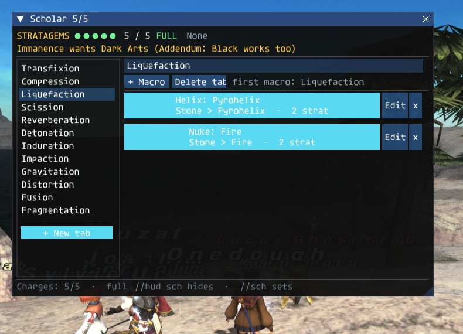
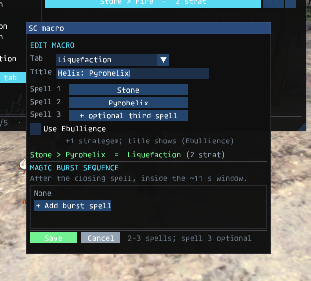
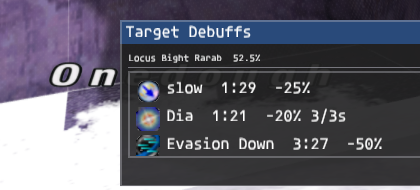
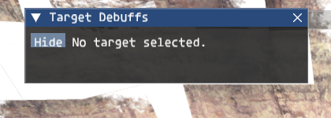
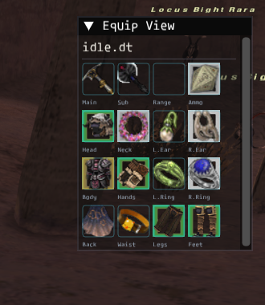
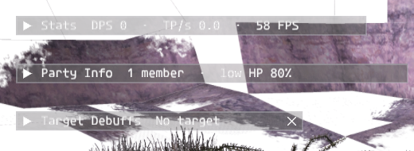

# Control panel, multibox and mules

The Fanxi Launcher doubles as a control panel for several running clients. It is a Rust + Tauri
app; the moving parts are the Rust process table that launches and polls each client and the
in-game control addon that already existed for `tools/xi_mcp.py`.

## One account per online character

FINAL FANTASY XI's login, lobby and zone sessions are keyed by account. A second login on the same
account replaces the first, so multiboxing means **one account per client**. The launcher supports:

- **Mules** — unlimited characters on one account (`FANXI_MAX_CHARACTERS=0` by default). Only one of
  them can be online at a time.
- **Accounts** — any number of saved accounts, each with its own API token. Add them from
  **Accounts → Add account**.
- **Launch all** — starts one client per saved account that has a selected character.

The server's `POST /launch` now records the chosen character on the login token. `game_login`
copies it to the game session, and the lobby's `0x1F` character list contains only that character.
The client therefore opens the mule the launcher picked instead of the first one on the account.
A plain username/password login still sees every character.

## Processes and ports

`launcher-rs/src-tauri/src/control.rs` owns:

| Concern | Behaviour |
|---|---|
| Control port | `54300`, `54301`, … one free loopback port per client, passed as `FFXI_CONTROL` |
| Log | `<data dir>/logs/game-<account>.log` |
| Duplicate protection | one live process per account |
| Stop | headless/remote: `//sleep` (process and session stay; character hidden). Visible local: `/shutdown`, then `SIGTERM` to the group, then `SIGKILL` |
| Polling | the UI asks the Rust core for a status snapshot every three seconds; the core polls each client's port |

The launcher leaves the game running if the launcher itself is closed; the control port dies with
the game process. The control port is loopback-only and unauthenticated, like the existing
`tools/xi_mcp.py` port: any local process can drive the game. Do not expose it beyond `127.0.0.1`.

## Control protocol

The addon listens on `127.0.0.1:<port>`, one JSON object per line:

```text
-> {"id": 1, "cmd": "metrics", "args": {}}
<- {"id": 1, "ok": true, "result": {"state": {...}, "kpi": {...}, "gear": {...}}}
```

Commands the launcher uses:

| Command | Result |
|---|---|
| `state` | login status, player (name, main job/level and support job/level), zone, target, menu, chat input (`chat_open`) and whether the game window has keyboard focus (`focused`) |
| `metrics` | state plus EXP/hr, rolling DPS, damage total, session seconds and active gear |
| `command {line}` | runs `//zone`, `//warp`, `//merits`, `/heal`, … as typed (no `/say` fallback) |
| `gear` | item id/name/bag/index, stack count and the encumbrance bitfield for all 16 equipment slots |
| `equip {slot, item}` | finds the item in the character's bags and sends `0x050` |
| `equip_set {items}` | finds every piece with one bag scan and injects the whole set of `0x050`s in a single frame |
| `gearswap {path, source}` | parses a GearSwap library in a sandbox and returns its `sets` table; `source` is the library's text when the file is not on the client's machine |
| `phase {path, source, enabled, engaged, idle_town, idle_field, move, default_ws, default_ja, ws_overrides, ja_overrides, spell_overrides, spell_category_overrides, spell_modes, focus}` | builds the precast/midcast/WS/JA/state plan from a GearSwap library (`source`, or the file at `path`) and hands it to the host (see below) |
| `phase_status` | the engine's rules, sets, counters, `state`, `town`, `zone`, `job`, `kiting`, `resting`, `focus`, `locked`, `lockedSlots` and armed `modes` |
| `phase_lock {locked}` | holds the set that is worn now (`true`) or resumes automatic swaps (`false`) |
| `phase_kiting {on}` | forced kiting state, on until switched off |
| `phase_resting {on}` | manual resting state (this server has no rest packet to follow) |
| `phase_focus {mode}` | idle focus: `auto`, `dt`, `pdt`, `mdt`, `eva` or `meva` |
| `phase_lock_slots {mask}` | pin equipment slots (bit 0 main … bit 15 back) out of every automatic set |
| `job_spells` | the current main/sub job's spell list for the override form, with the spell-override `categories` the host will use; a level-99 main job also includes its job-point spells |
| `job_abilities` | the main/sub job abilities the client's 0x0AC command list advertises, with action ids and types |
| `weapons` | main/sub/ranged/ammo items in all 18 client bags (slots 1-80) that the main job meets the level and job requirements for, with copy and stack counts |
| `bag_items {container}` | every item in one client container (diagnostic; scans slots 1-80, including slots past `container_max`) |
| `icons {ids}` | item icons as top-down RGBA hex, decoded from the game's DATs |
| `item_ids {names}` | item name -> id, for launcher-side GearSwap set previews |
| `hud {show_hud, show_abilities, show_spells, show_trusts, show_weapon_skills, show_mounts, show_target, show_equipview, show_battle_hud, show_sch, edit, type, layout, columns, size, labels, font, tabs, group, custom_groups, assign_key, assign_group, target, target_tab, targets, warp_marks, mounts, opacity, menu_hide, reset_positions, center_positions}` | change the whole in-game HUD or one of its combat windows (or all of them); `edit` starts/stops in-game move mode, `center_positions` parks all six windows in the middle before editing (the resolution-change repair); `target` + `target_tab` or a `targets` map sets per-tab spell targeting (`selected`, `stnpc` or `stpc`); `warp_marks` is the launcher's `[{slot, alias, zone_name}, ...]` list for the Zoning spell page; `show_mounts` opens the Mount HUD and `mounts: {selected, columns, size, x, y}` sets its own prefs; `show_battle_hud` drives the camp Battle HUD (the same setting as its title-bar X); returns the saved state |
| `battle_info {show, toggle, start, pause, stop, reset, auto_start, native_fps, advanced, opacity, x, y, reset_position}` | the Stats window and the measurement session; returns the live snapshot |
| `battle {action, profile, name, role, radius, scope, line, tab}` | the Battle hub and automation engine: `state`, `update`, `save`, `load`, `delete`, `new`, `start`, `stop`, `pause`, `show`, `hide`, `tab`, `camp_hud`, `camp_here`, `camp_radius`, `camp_clear`, `place_there`, `suggest` or `command`; see [battle.md](battle.md) |
| `party_info {show, toggle, tab, replace, buffs, names, opacity, x, y, reset_position}` | the Party Info window; `tab` is `party` or `alliance`; returns the saved state and the member list |
| `follow {enabled, leader, distance}` | follow a character: replay its trail with native auto-run |
| `follow_status` | `enabled`, `leader`, `state`, `distance`, `stuck`, `leader_found`, `trail` |
| `follow_events` | drain the queued `//follow` commands the client's chat blocked |

In the launcher, the Gear window is under **Gear** in the sidebar (or **Gear & GearSwap** in the
Control room, or by double-clicking a live row). It follows the global tenant bar: the selected
tenant's running client supplies the live gear. Its **Import GearSwap file…** button is the entry
point for a user's `.lua` sets; the parsed file is saved as that account's library for the current
job, and the Gear page edits the same row. The shared `gearswap/<JOB>.lua` files are only the
template for a new account.

### Follow

The **Follow** card in the Control room assigns line leaders by drag-and-drop or a per-box select.
The follower's client records the leader's horizontal path at frame rate (one waypoint every 8 cm)
and replays it in order with the game's own auto-run (`FollowDeltaX/Y`, `IsAutoRunning`), so the
client still owns collision, animation and position packets. The follower steers at the next
waypoint it has not reached — not at a point measured back from the leader's current position — so
it takes the same corners the leader took instead of cutting across the inside of them. A pass test
covers a 30 fps client stepping over a waypoint between frames, and a zone change or warp (a jump
over eight yalms) starts a fresh path. The trail keeps 2,400 points (about forty seconds at 60 fps).
The follower stops `0.8 ×` the spacing behind the leader's newest point (0.8 yalms at the default
spacing of one) and follows on when the leader moves. A sustained sprint can outrun the
auto-run; the follower stays on the recorded path and closes the gap when the leader slows or
stops instead of cutting the corner to keep up. A follower with no leader in view reports
`waiting`; after seven seconds the launcher sends `//pos` (same zone) or `//zone <zone> <x> <y> <z>`
(other zone) to recover it. The control addon reports the client's own axes (`x` and `y` are the
ground plane, `z` is height), while those commands take the server's order (`x`, height, `z`), so
the launcher swaps the last two before sending. Without that conversion a recovered box lands
hundreds of yalms above the world, outside every entity list, and stays `waiting` forever.
Automatic recovery stops after three hand-offs and does not run while the client is still
loading. A box that is still `waiting` or `stuck` shows **Fix** beside the badge: it kills the
client, relaunches the account (a remote Linux box goes through the same restart helper), zones
it to its line leader, and re-applies follow. That is the manual escape hatch for a client whose
entity table never saw the leader, which another position packet cannot repair. A follower that
cannot make progress reports `stuck` after four seconds; `follow_status` reports `points`,
`cursor` and `goal` so a stuck cursor is easy to see.

Chat commands are handled in the client addon and blocked from reaching the server:

```text
//follow me all                  every running box follows the sender
//follow p1 p2 p3 p4             p2-p4 follow p1
//follow stop p1                 p1 stops following, its own followers stay with it
//follow me p1                   p1 follows the sender again
//follow stopall                 everyone stops following
```

The launcher drains these with `follow_events` and applies the same graph as the Follow card. A
leader may itself follow another leader; cycles are rejected by the launcher.

### Team jobs

The Control room's **Party jobs** card (and the Team page's **Team jobs** card) lists the whole
team in one place: the main account and every box, with its character, `@account`, slot label,
main job and level, support job and level, and live state. A running client's control state wins,
so a `//job` change shows on the next poll; an offline box uses its saved character row. A
highlighted row is the current tenant. The strip above the rows lists the distinct jobs the team
covers, with a count when more than one member brings the same job.

The **Live party** table also has a **Job** column (main over support), and each party row, the
selected equipment card and the KPI summary show the pair. The control addon's `state` reply
carries `sub_job`/`sub_level` beside `job`/`level`, so the launcher follows a job change in the
Mog House or at a Nomad Moogle. An older client without those fields falls back to the saved
character row.

### Combat HUD

Every running account in the **Control room** has a master **Show HUD** switch and per-window
switches beside its character picker: **Abilities**, **Spells**, **Trusts**, **Weapon skills**,
**Stats**, **Party info**, **Battle HUD**, **Target debuffs**, **Equip View** and **Magic Bag**.
The master switch is the same one `//hud` and Ctrl+H use; while it is off the per-window
switches keep their state but nothing is drawn. They drive the in-game ImGui windows drawn by the
control addon:

- **Abilities** lists the job abilities the client's `0x0AC` command list advertises for the
  current main/sub pair. It groups by main job and sub job by default; a Scholar's list splits
  further into **Light Arts**, **Dark Arts** and **Other** instead of one long SCH page.
  Dancer waltzes and sambas show their effective TP cost on the icon and are dimmed with a red
  border while the current TP is short; clicking a dimmed tile is ignored and its tooltip says
  how much TP is needed.  The cost accounts for `Waltz TP Cost` gear, Trance and Contradance.
  Recast-only abilities (steps, jigs, flourishes) do not use TP: they stay at full brightness
  and use the normal cooldown clock.  An ability already on cooldown shows the clock even when
  its TP cost is affordable.  The clock and the tooltip read in minutes and seconds rather than
  raw seconds: 300 s is **5m**, 299 s is **4m59s** and 45 s is **45s**.
  A Corsair's page keeps **Phantom Roll** and **Quick Draw** as two menu doors instead of listing
  all 31 rolls and eight shots as tiles. **Phantom Roll** opens a searchable picker of the rolls
  the job pair has learned, sorted by level acquired (the default) or name; **Quick Draw** opens
  the eight elemental shots in element order in the action-tile grid. Picking a row or a shot
  closes the picker and runs the same `/ja` path as a tile. The rolls share their recast, so the
  roll rows and the **Phantom Roll** tile show the same clock; a shot uses the same cooldown
  sweep as the action tiles. `//hud roll` and `//hud quickdraw` open the same two pickers from
  chat.
- **Spells** lists the same job pair's spell table, with trust magic removed. **Trusts** is its
  own window and groups by the trust's main job (Kupipi WHM, Trion PLD, Shantotto BLM, …). Its
  buttons use cropped portrait faces bundled from the BGWiki trust cards, with the full trust name
  and level still in the hover tooltip. A button runs `/ma "<name>" <me>`; the server calls that
  alter ego, and it follows you and attacks your current target. While a Trust is out its button
  gets a cyan border and an active dot; clicking it again releases that Trust through
  `//trust release <spell id>`. **The configurable support Trusts are the exception:** Joachim,
  Luzaf, Qultada, Koru-Moru, Sylvie (UC) and Ygnas open a small menu with **Call** (or
  **Dismiss** while out) and **Set songs**, **Set spells** or **Set rolls**. The dialog lists the
  Trust's full spellbook (every main-job spell, its support-job spells up to 49, and all
  Indi-/Geo- spells for Sylvie) with the level each unlocks at; tick up to 24 in the order
  they should be used and **Save**. **Use default logic** is the checkbox that returns the Trust to its
  built-in rotation (and disables the list). The set is stored on the character by the server
  (`//trust <id> set ...`), so it survives a relog; the HUD reads the catalogue and selection back
  through hidden `TrustData|` lines rather than printing chat. A Trust with no selected actions
  uses the default logic.
- **Magic Bag** is the inventory and Recycle Bin HUD. The launcher fetches
  `/api/v1/characters/<id>/magicbag` (visible bags, Storage Slips, `char_locker`, and the
  Armory purchase history as Claim Storage) and
  pushes the merged rows with the `show_inventory` patch; the window shows item icons, search,
  bag filter, sort, a single highlighted selection, select-all, a **Move** destination dialog
  (client bags plus **Magic Bag (9999)**), recycle with confirmation, restore, and a **Pull**
  action for a slip/locker row (`//item pull <slip|locker> <id> [extra] [count]`). The bag/source
  and action columns have fixed starts, and the bag label is clipped to its column, so
  **Magic Bag (locker)** can no longer run underneath the **Pull** button. Double-clicking any
  row opens a modal full item card with the client's item name and description, every augment
  line, and the copy's **Path / Rank / RP** when it carries an Odyssey, Limbus, Oboro or Unity
  bundle block; **Close** returns to the table for Move, Pull or Recycle. Its state is the same
  `show_inventory` field and saved per-character HUD file.
- **Weapon skills** lists the client's weapon-skill actions (ids 1-255) and runs `/ws "Name" <t>`.
  It groups by weapon type: Hand-to-Hand, Dagger, Sword, Great Sword, Axe, Great Axe, Scythe,
  Polearm, Katana, Great Katana, Club, Staff, Archery or Marksmanship. The equipped weapon's icon
  sits beside the group title. The list is the server's 0x0AC menu, so it follows both the
  equipped weapon's skill type/value and the main-job restrictions on relic/mythic/empyrean and
  merit weapon skills; the tab does not offer a skill that `/ws` would refuse. Each button shows
  the skillchain element it can open (the BGWiki element badge) with an L1/L2/L3 badge; a weapon
  skill with no property falls back to the weapon icon. The header carries current TP
  (`TP n / 1000`), the skillchain-window countdown (wait, then go), and a dropdown for the
  skillchain being hunted. Matching buttons get a coloured border; the rest dim. Below 1000 TP
  every weapon-skill tile is dim and clicks are ignored. Hovering shows the interpolated fTP at
  the current TP, the hit count and all three resonance properties.

All four windows follow the live job pair and the client's `0x0AC` command list. A job change
rebuilds them once the new job's gear and its command data have settled, so the Abilities and
Weapon Skills lists swap to the new job's weapon instead of keeping the old one until the HUD is
reopened. This works the same from `//job` and from the Mog House or Nomad Moogles' Change Job
menu. A rebuild that only changes the weapon (a gear swap on the same job) keeps the cooldown
bars of abilities that survive it. The same snapshot is refreshed on every launcher poll, so the
Control room's counts follow the change even while the windows are hidden.

**The Scholar HUD is the job's own window.** It opens by itself for a Scholar main job and steps
aside on every other job until the player makes a choice: the Control room's **Scholar** switch,
`//hud sch` and the window's title-bar X store that choice in the character's HUD file. The
header is **strategems**: one pip per charge the job has (five at 99, one more every twenty
levels from 10), the count left, and the clock to the next charge, with the next pip filling as
the four-minute recharge runs down. Every Immanence and Ebullience spends one; the count follows
the outgoing job-ability packet, so a stratagem used from the Abilities window or a macro keystroke
counts the same as one clicked here. The charge state is persisted with the sets, so a logout does
not give them back. A **Dark Arts** chip warns when the active art is Light or none, because
retail's Immanence wants Dark Arts; **Addendum: Black** is accepted too.

The body is a left-hand list of **tabs**, one per skillchain, each holding the player's own named
macros. A fresh character gets the twelve chains (Transfixion, Compression, Liquefaction, Scission,
Reverberation, Detonation, Induration, Impaction, Gravitation, Distortion, Fusion, Fragmentation)
seeded with the pairs from the old Scholar library — Stone → Pyrohelix for Liquefaction, Blizzard
→ Noctohelix for Compression, Aero → Noctohelix for Gravitation, and so on — plus the no-Helix
variants where they differ. A tab can be renamed in place, added with **+ New tab**, or deleted
with its macros. A macro is a title, **two or three spells**, an optional **Use Ebullience** check
(its title then reads `(Ebullience)` and it costs one more charge), and an optional **magic burst
sequence**: a list of spells cast after the closing spell, inside the skillchain window. The
editor is a modal with a tab picker, a title, a searchable spell picker for each slot (Divine,
Elemental and Ninjutsu spells), a live preview of the chain the chosen spells form, and the
burst list. Deleting a macro or a tab asks for confirmation.





Clicking a macro runs the sequence the way the old GearSwap library did, which is still the
timing that works in game: `/ja "Immanence"`, one second, the spell; then five seconds before the
next Immanence when the next spell is a Helix and four seconds otherwise; after the closing cast,
each burst spell. **Stop** cancels the sequence. A macro whose spells (plus Ebullience) need more
charges than are left is dimmed and shows the clock to the next time the whole chain is payable --
`next 7:59` for a two-spell macro with none left -- and clicking it repeats that in chat rather
than sending a sequence the strategems cannot cover. Nothing here bypasses the client's own
checks: each step is an ordinary `/ja` or `/ma`, so range, cast bars, recast and the server's
packet validation still apply, and the server now forms the skillchain itself
(see [skillchains.md](skillchains.md)).

`//sch on|off|toggle` shows or hides it; `//sch save` writes now, `//sch reset` restores the
twelve default tabs, `//sch position` re-centres the window after a resolution change,
`//sch charges <n>` corrects the gauge, and `//sch stop` cancels a running sequence. The sets and
the charge clock live in `<data>/sch/<character>-<id>.sch`, one TAB-separated line per tab and
macro, separate from the HUD layout file so the launcher's layout editor does not rewrite them.

The icon on each tile is the game's own menu icon: the addon's resource layer reads the icon DAT
(`ROM/280/15.DAT`, file id 39551) and decodes the 32x32 DXT3 image for the spell/ability
`icon_id` (`res.menu_icon_rgba`); trust faces and skillchain badges are bundled 48x48 atlases
from the BGWiki cards and icons. Missing art falls back to a lettered tile, never to a broken
texture. Clicks run the game command (`/ja`, `/ma` or `/ws`), so the client's own range, target
and recast checks still apply. The button immediately darkens and a clock-style sector unwinds
from the top; the sector covers the recast that is left and the icon is fully unveiled and
clickable again when `spell_recast` / `ability_recast` reaches zero. A click that the game refuses
clears after the short pending window instead of sticking. Every poll reads the whole
`ability_recast` table, not only timers this HUD started, so a cooldown the server restored after
a relogin (Bestial Loyalty's 20 minutes, a two-hour) is already dark on the first frame instead of
looking ready.

**A ranked spell shows its line, not a bare numeral.** The client's menu art for `Aero II`,
`Cure III` or `Blizzaga II` is a generic Roman-numeral tile, so a spell page used to be a grid of
nearly identical numbers. The Spells window resolves the unranked spell (`Aero`, `Cure`,
`Blizzaga`) through `res.spell_by_name`, draws that line's icon and puts the Roman rank in a small
badge at the icon's top-right; a tier-I spell has no badge, and a rank changes only the badge.
The original numeral tile stays as the texture fallback when the line art is missing, and a Trust
keeps its portrait (a Trust named `Prishe II` does not lose its face).

The name under the icon is line-aware for the same reason: the old four-letter rule made
different lines share a label (`Aero II` and `Aeroga II` both `AERO2`, `Blizzard` and `Blizzaga`
both `BLIZZ`, `Stone`, `Stonega` and `Stoneskin` all `STONE`). Spell labels now keep the line half
plus its suffix letter (`-ga` is G, `-ra` R, `-ja` J) and append the Arabic rank: `AERO2` /
`AEROG2`, `BLIZZ` / `BLIZG` / `BLIZR` / `BLIZJ`, `THUND` / `THUNG`, `STONE` / `STONG` / `STNSK`.
All distinct spell lines get unique short labels of at most seven characters (for a Bard song the
rank lives on the badge, so label plus rank is unique); the narrow tile fallback keeps the line
and the rank as well. A name the client repeats (its two `Sleepga`
records) is one tile, since the HUD casts by name. Trusts use the same naming rules but skip the
spell-line suffixes (Nashmeira stays `NASHM`), which also separates Unity versions (`ALDO` /
`ALDOU`).

**The Bard page also has a **Bard songs** mode group in the Spell mode groups: **Song duration** uses `midcast.SongDuration` (Loughnashade and every 454 and Song+ piece), **Song potency** uses `midcast.SongPotency`.  Song+ counts 10% duration a point, so the same loadout wins both and the two modes name the same set.  Honor March and Aria of Passion automatically use `midcast.SongHonor` / `midcast.SongAria`; the required Marsyas/Loughnashade sits in `precast.FCHonor` / `precast.Song` because the server checks it when the cast packet arrives.  Switch with `//modes songs duration|potency`.  The Spells panel has separate **Spell precast** and **Song precast** selectors (`precast.Spell` / `precast.Song`) and a **Song overrides** card that lists only Bard songs, each with its own precast and midcast set.

Bard pages are grouped by effect and colour.** An ungrouped Buff tab held nearly eighty song
tiles, so the Spells window now splits each Bard page into effect sections: Haste (March,
Mazurka and Honor March), Attack (Minuet, Mambo and Aria of Passion), Defense (Minne and
Protected Aria), Magic Defense (Carol and Scherzo), Accuracy (Madrigal and Prelude), Recovery
(Ballad, Paeon and Hymnus), Etude (the stat songs) and Support (the resistance and utility
songs). The Debuff page splits into Damage (Requiem), Slow
(Elegy), Elemental (Threnody) and Control (Lullaby, Nocturne, Virelai and Finale). Every section
has a coloured band and heading with the families it holds, and its notes and tile borders use
the same colour, so an eighty-song page reads as eight coloured blocks instead of a wall of white
notes. A song tile is labelled with its line, not the old first-word-plus-initial soup: `Army's
Paeon IV` is `PAEON` with a `IV` badge, `Knights Minne` is `MINNE`, and `Fire Carol II` is
`FIRE C` with a `II` badge. Honor March is `HONOR` in the Haste section, and Aria of Passion is
`PASSION` in Attack, so the two instrument-granted songs (Marsyas and Loughnashade) are not left
in Other. Etudes read by the stat they raise (`STR`, `DEX`, `VIT`, ...), with a
`+` for the stronger member of each pair (`Herculean Etude` is `STR+`). The rank is deliberately
left off the label because the icon already carries it; a hover still shows the full name. The sections follow the type and skill pages (the
normal Buff/Debuff tabs and the Bard Song page), including when tabs are off; element and custom
groups keep the player's own split.

**Layout** opens the per-account editor. Each of the four types has its own tab and its own saved
layout:

- **Grid** (3-12 columns), **List** or **Bar**.
- **Folder tabs** (on by default) put one group on each page. Click the tab strip at the top of
  the window to flip between Buff/Debuff/Nuke, main/sub job, a trust job or a weapon type
  instead of scrolling through the whole list. Turning tabs off stacks every group with headers.
- **Group by**: spells by type (healing, buff, debuff, nuke, zoning, avatar), magic skill or
  element; abilities by main/sub job or ability type; trusts by job; weapon skills by weapon type.
  Every type also offers **No grouping**.
- **Custom groups**: create named groups and drag items from **Unsorted** into them. The game
  draws the groups in the order shown, and remembers which item belongs where.
- Tile size 32-72 px and label size 7-12 px. The window chrome is only a few pixels of padding;
  with tabs on, the bar is one tab row plus one row of tiles. Labels appear under the icon in
  grid and bar; they use short, stock-style abbreviations and never an ellipsis (a spell's label
  is its line plus rank, and a song leaves the rank to the icon badge, as above). Hovering a tile
  always shows the full name, level and recast, even when labels are off.
- **List** width is measured from the longest name in that window, so it fits the text instead of
  using a fixed column. **Grid** and **Bar** set their width and height from the tile size so the
  cells sit flush inside the window.
- **Edit** turns on move mode in game: each visible window grows a title bar
  (`Spells (40) - drag to move`) and is moved by dragging it, and the two hubs get the same accent
  outline. An opaque **Done** box sits in the middle of the screen and is drawn above every
  window, so it stays readable and clickable while a window is being dragged. Either click
  **Done** or type `//hud save` to save every position and leave. Drag positions are also saved
  when the mouse is released. **Reset positions** puts the visible windows back in their default
  corners.
- **Hide the HUD when a menu or chat is open** hides every Fanxi HUD window (the four action
  windows and the two hubs) whenever a client menu is open or the chat line is being typed in,
  while the game window has focus. The menu hide is suppressed while the player is engaged or has
  a live target, so opening the battle/ability menu mid-fight keeps the HUD usable. An open but
  empty chat line, or the launcher being in front, does not hide it; this is why **Done** in the
  layout editor shows the HUD immediately.

**In-game move mode.** `//hud move` (alias `//hud edit`) starts the same mode without the
launcher, and `//hud save` writes the layout and leaves it. `//hud move reset` first parks all six
windows (the four action windows and the two hubs) in the middle of the screen and then starts
move mode; that is the repair path after a resolution change, when a window saved outside the new
back buffer cannot be seen or grabbed. A window that is switched off at reset time keeps its
middle position for the next time it is shown. Leaving the HUD with `//hud off` or Ctrl+H also
leaves move mode, because a hidden HUD has no Done box to click.

**Call Beast jugs and Pet Commands.** Clicking **Call Beast** or **Bestial Loyalty** in the
Abilities window opens the jug picker instead of using the ability immediately. It lists the
Call Beast jugs in the character's equippable bags (with the pet and stack count), refreshes while open, and
wears the clicked jug, then calls the ability once the client sees it. **Pet commands** opens the commands
for the pet that is out; a jug pet gets its Ready moves in the same window, while a charmed pet
gets Leave/Sic. The same two windows are available as `//hud jug` and `//hud pet`.

**Target Debuffs.** The client never receives a monster's buff list, so this window asks the
server for the selected target's live effect state through the launcher API. It is on by default;
the title-bar arrow minimises it to the title (like the Battle HUD and Magic Bag), the title-bar X
and the **Hide** button close it, and `//hud target` / `//hud target on|off` toggles it from chat.
Each row shows the effect icon, the
spell name when the server recorded it (Dia, Frazzle, Slow, Distract, ...), the time left, and the
potency or damage tick. Dia's row is the server's actual Defence Down percentage, and Frazzle's row
is its actual Magic Evasion Down, so the window distinguishes "landed" from "did nothing". The
window follows the selected target, hides with the other HUD windows when a menu or chat line opens,
and remembers its position per character. The poll names the character by the client's ServerId
(the long `0x01000000 | char_id` value from the entity table), so the API accepts either that or
the database row id; an error is shown by its `message` ("Target info unavailable: character is
not in a zone"), never as a raw table. The API URL may be HTTP or HTTPS: the HUD uses LuaSocket
for HTTP and libcurl through LuaJIT FFI for HTTPS.





**Equip View.** The in-game EquipViewer, styled as the client's own equip window: the blue
**Equip View** title bar, the set line under it, and a flush 4×4 grid of the worn pieces in
Windower's order (main/sub/range/ammo, head/neck/ears, body/hands/rings, back/waist/legs/feet).
The cells touch — there is no label row under the icons — and the game's own item icons fill
them, carrying the equip screen's coloured backgrounds. An empty slot names itself *inside* the
box as a faint watermark, the way the client's item picker labels an empty tile; a tooltip names
every item, and a pinned slot (`//gs lock`) draws a red border.
The window is read from the client every frame, so a gear swap draws the instant it happens —
what the original addon bought with its `0x050` packet hook. Minimised, the title bar carries the
set the GearSwap engine is wearing: `WS.Blitz` in gold, with its age, while a weaponskill holds
its own set, otherwise the state set (`idle.dt`, `engaged.tp`, …). It is on by default;
`//equipview on|off|toggle|reset` (or the **Equip View** switch in the Control room) toggles it,
and `reset` parks it in the top-right corner. Position and collapsed state persist per character.



**Collapsing hubs.** Every hub keeps the normal ImGui title bar: click the **caret** to collapse it
to that one title bar, and click again to expand. (Equip View paints the game's blue bar over its
title bar but keeps that caret and the drag.) While collapsed, the title bar shows the hub's
key status:

- **Stats**: DPS, TP/sec and FPS.
- **Party Info**: member count and the lowest party HP.
- **Target Debuffs**: target name, HP percentage and active debuff count.
- **Magic Bag**: filtered item count and the selected bag.
- **Equip View**: the set the GearSwap engine is wearing (`WS.Blitz` with its age while a
  weaponskill's set is on, otherwise `idle.dt`, `engaged.tp`, …).
- **Battle HUD**: RUNNING/STOPPED and the current target with its HP percentage.

The windows stay draggable by their title bars, and the collapsed state does not add another row or
button. **The collapsed state and position are saved** per character, so a logout/login reopens the
same minimized bars in the same places (the Battle HUD keeps its own copy in the Battle profile).
Target Debuffs, Magic Bag and the Battle HUD also keep their title-bar **X**; Stats and Party Info
use their **Hide** button or the Control room switch.



**Ctrl+H** hides or restores every Fanxi HUD window in one stroke: the four action windows, Stats,
Party Info, Battle HUD, Target Debuffs, Magic Bag and the native FPS readout. The same switch is
`//hud [on|off|toggle]` in game or the control port's `hud {show_hud: false}`. This is a master
switch, not a reset: the per-window switches keep their state, so turning the HUD back on brings
back exactly what was
visible before. The key works with the chat line open or closed; it is consumed, so it never types
an H.

The addon saves the six switches (the four action windows and the two hubs), the master HUD switch,
each type's layout/labels/font/grouping/custom groups and all six positions per character in
`<data dir>/hud/<character>.json`. A toggle flipped while the
character is still at the login screen is carried into the character's file when it logs in. The
switches are restored on the next launch and shown from `metrics.hud`, so two clients on different
characters keep independent layouts.

**The Mount HUD** is its own window rather than one of the six: `//mounts` (or bare `//mount`)
opens it, and the `hud` command's `show_mounts` / `mounts` fields drive it from the Control room.
It shows a picture of every mount the client knows; click a card (**Mount**) to call that one, or
press **Mount party** to give every box in the sub team its own random mount. The window keeps its
own position, picture size, columns and picked mount with the other HUD prefs. See
[mounts.md](mounts.md).

The launcher talks to the addon's `hud` command through the Tauri `send_hud` bridge. A patch names
the tab it edits with `type` (`abilities`, `spells`, `trusts` or `weapon_skills`); an older
launcher that omits `type` still applies layout fields to all four. `custom_groups` replaces the
custom group list, and `assign_key` + `assign_group` moves one item (an empty group clears it).
Invalid values are clamped or ignored. `metrics` includes the same state as `hud`, which is what
the Control room's switches render.

**Spell target modes by tab.** Each spell tab keeps its own saved `Tgt:` setting. Heal and Buff
default to **STPC**; Debuff, Nuke and Zoning default to **Selected**. The `Tgt:` button in the mode strip
cycles the active tab through **Selected → STNPC → STPC**; switching tabs shows that tab's saved
setting, and spell clicks use it. Selected sends `/ma "Spell" <t>` (or `<me>` when nothing is
selected); STNPC sends `<stnpc>` to open the NPC sub-target cursor; STPC sends `<stpc>` to open
the party sub-target cursor, where Tab walks through your party. Hovering `Tgt:` shows the
description in a fixed caption under the mode strip, not at the cursor. Set one tab with
`hud {type: "spells", target: "stnpc", target_tab: "Debuff"}` or set several with a `targets` map.
The server applies the selected party member for party-target buffs and heals; genuinely
self-only spells such as Temper II still resolve on the caster.

**Zoning.** Warp, Warp II, Escape, Retrace, the Teleport-\* and Recall-\* spells get a **Zoning**
page of their own instead of being sorted into Buff or Nuke by their magic skill. The page also
shows the character's saved `//warp` places: the launcher reads them from the server (the addon
cannot query that table) and pushes them through `hud {warp_marks: [...]}` on its poll and whenever
the Warps page changes a mark. A client started without the launcher draws the Zoning spells but
has no mark rows until a launcher connects. A mark tile uses the Warp icon, is labelled with its
alias (or zone name when it has none), and a click runs `//warp me <slot>`; the tooltip names the
zone and slot. Marks are not written into the per-character HUD file, so a rename or delete on the
Warps page is the one copy that matters.

### Battle hub and automation

`//battle` is the automated Battle hub described in [battle.md](battle.md): per-character rosters
(tank, puller, kiter, support, melee, ranged), camps with a ground ring, engage gates based on the
mob's claim, a tank-anchored melee formation, pull/sleep rules, healing/buff/enfeeble/dispel/status
removal priorities, death and kiting policies, and saved profiles the launcher's **Battle** page
edits through the control port's `battle` command. It runs on the client, through the same client
commands a player types, and never sends server-side automation.

## Stats and Party Info

Two more in-game windows live beside the action HUD. They are plain ImGui text and bars, use the
same per-character file (`hud.state.battle` and `hud.state.party`), and are opened with
`//battleinfo` / `//partyinfo` (alias `//info` / `//party`) or from the control port with the
`battle_info` and `party_info` commands; the Rust launcher's Control room shows **Stats**,
**Party info** and the **Battle HUD** switch beside the four action-HUD ones. Each window has its own `Hide` button,
title-bar drag and saved position.

**Stats** (the `show_battle_info` field and `//battleinfo` command) measures the player's own
session from the client's `0x028` action packets and the live TP bar:

- `Start` begins a session (or resumes a paused one), `Pause` freezes the clock and the 60-second
  window, `Stop` ends it, and `Reset` clears every counter and starts fresh. With **Auto-start on
  damage** on, the first outgoing action opens a session; a Stop suppresses auto-start until Start
  or Reset. The state badge reads `READY`, `LIVE`, `PAUSED` or `STOPPED`.
- DPS (session and rolling 60 s), peak 10 s, total/melee/WS/magic/ability/skillchain damage, max
  and average hit, melee accuracy, hit and miss counts, critical rate, WS count/damage/accuracy,
  damage taken, DTPS, kills and EXP/hr.
- **TP to 1000** times the next cycle from 0 TP: elapsed seconds, hits, TP/s, TP per hit, an ETA
  while the bar fills, and the last/average completed cycles. A missed swing adds no TP and a
  weapon skill that empties the bar starts the next cycle.
- The renderer's frame-rate overlay moves here: the window shows FPS, frame milliseconds, a 1% low
  from the last few seconds and a sparkline. While Stats is shown its
  **Native FPS overlay** checkbox is off by default, so `xi.fx('fps', 0)` hides the top-left
  counter; hiding the window restores the previous setting. If the running `host64` predates
  `xi.fx`, the checkbox is shown disabled with a note and the native counter stays.

**Party Info** has **Party** and **Alliance** tabs. It is empty while solo; `/pcmd add`, the
party menu's invite, `/acmd add` or the alliance menu forms the group the window reads. Each row
shows the member's name, job/sub-job
and level, HP/MP/TP bars with numbers and percent, and the status-effect icons the client holds for
that member (hover lists their names; **Names** adds a short line under the icons). The player's own
buffs come from `player_t.Buffs`; the other five from `partystatusicons_t` via packet `0x076`.
Alliance members outside the player's own party have no status data in the client, and the row says
so rather than showing an empty strip.

The **Make party** button in the same header sends `//makeparty`: every online sub-account leaves any
other party it is in, then accepts an invitation to the button's character. The caller must be the
party leader or solo; a sub already in that party is left alone.

**Replace game list** makes the window opaque (and draws a dark backing behind it) so it covers the
client's own party list while it is shown. This is an overlay replacement: the client still draws
the native list underneath, and moving the window uncovers it. That is deliberate for now - the
native list is also the only place the client exposes some party interactions - but the window is
positioned over the usual top-left list and its opacity is forced to 100%, so the visible result is
the new list.

### Inviting the team

The **Live party** header has an **Invite** button that acts on the highlighted row. It opens a
picker with two shapes: **Invite all online subs** sends `//invite subs`, which the server resolves
itself, so the boxes do not have to be near the inviter or even in the same zone; the list below it
names every other running character, and each row's **Invite** sends `//invite <name>` from the
highlighted client. A family sub accepts automatically; a main account or another player's
character still gets the normal prompt. The inviter must be the party leader if it is already in a
party. If the highlighted client is the main and its subs kept the party after it dropped,
**Invite all online subs** first rejoins that party and takes the lead back, then fills in any sub
that is missing, so it is also the recovery button.

### Warps

**Warps** in the sidebar (and the **Warps** shortcut in the Control room) is the friendly face of
`//warp` (see [launcher.md](launcher.md)). It lists the selected character's saved places
with the number, alias, zone and coordinates; **Mark** stores the live client's current position in
the server's coordinate order (`x`, height `y`, ground `z`; the client reports height as `z`, so the
page swaps the last two before saving), **Warp** sends `//warp me` or `//warp all` for the chosen
target, and the pencil/trash buttons rename or delete a row. **Warp team to me** sends `//warp all me`, which keeps this character where it is
and calls every other online character in the account family to its zone and position. A warp is
always a short `0x00B` hand-off, even when both characters are already in that zone, because the
client ignores a server position update for its own character. A whole team is handed in one box
at a time so five clients do not contend for the same reconnect window. The same
button is in the Control room's **Live party** header and acts on the highlighted row. Aliases can
be edited while the character is offline; marking and warping need the selected character's client
running because the position and the destination are on that session. `//warp call <name>` is the
one-box form of the same call (it is what the automatic pull after a relog sends); `//warp all me`
is still the button.

The page can manage a main character or a sub-account character; the launcher's token is allowed to
read and edit the whole account family (`account_can_manage_character`). The tenant bar's selection
is the character whose list is shown, so changing the tenant changes Home, Data, Gear and Warps
together. The REST routes are:

| Route | Result |
|---|---|
| `GET /api/v1/characters/{id}/warps` | `{character, warps, limit, next_slot}` |
| `POST /api/v1/characters/{id}/warps` | mark; optional `alias`, `zone`, `x`, `y`, `z`, `rot` (otherwise the server uses the character's saved position) |
| `PATCH /api/v1/characters/{id}/warps/{slot}` | `{alias}`; an empty alias clears the name |
| `DELETE /api/v1/characters/{id}/warps/{slot}` | delete one |

The "Everyone" target is the same selection `//warp all` makes on the server: the sender's main
account and its sub-accounts that are online, not every client in the launcher. A mark made in game
appears in the page after **Refresh** (or immediately after a page action).

### A stuck box

A running process is not a running character. When a box loses its zone session — a server restart,
a silent UDP drop on a remote host — its client keeps rendering the last frame and its control port
keeps answering. Its own `login_status` (`host/addons/game.h`: 0 no character block, 1 logging in or
zoning, 2 in world) cannot see the restart: the client keeps the last zone and can report 2 for a
while. The live table therefore checks each client against the server's **live zone roster** —
`GET /api/v1/world/online`, the same live roster `/sea all` reads, built from `World.sessions`,
not from the `game_sessions` login rows that survive a restart.

- **2 and in the roster** is online. It enables **Invite** and **Warp team to me**, and it is what
  `//warp all me` can actually move.
- **2 but not in the roster**, after 15 s: **orphaned**. The process and its SSH tunnel are still
  there, which is exactly what used to look healthy. The row offers **Reconcile**, and the card
  offers **Reconcile N** for every stale box at once.
- **1** shows `zoning` and is left alone; a zone change is not a stuck client.
- **0** shows **logged out** with a **Relaunch** button. The account's own sign-in line says the
  same.
- If the roster is unavailable (older server, game gateway off, network failure), the launcher
  falls back to `login_status` alone; an unreadable roster must never mark every box stale.

**Relaunch** stops that client and starts the same character again: an attached Linux box goes
through the same helper that started it (`scripts/linux_boxes.py restart --only <id>`, same tunnel
port, so the launcher adopts it again), while a local client is stopped and relaunched through the
normal token path. **Reconcile N** does the same for every orphaned session, one after another, so a
server restart needs one click instead of one per box. The warp back is automatic: the launcher arms
it when a client leaves the world, or when **Relaunch**/**Reconcile** is pressed, and fires
`//warp call <name>` from the leader once that account has reported 2 for two 3 s polls. Only the
returning box moves, so the rest of the team is not teleported again. The leader is the main
account's in-game client when there is one, otherwise the first in-game client. A box that has never
been in world during this launcher session is not armed, so a fresh Launch still starts where the
character stands.

The server's `/status` `online` count uses the same live roster while the game gateway is attached;
without a gateway it falls back to the `game_sessions` row count.

### Command completion

The game's own command assist knows slash commands, not Fanxi's `//` chat commands. The host
completes them itself: while the chat line starts with `//`, **Tab** rewrites the line
through `host/addons/complete.c` and keeps the key from the game. A unique match is completed with a
trailing space (`//wa` -> `//warp `, `//warp ma` -> `//warp mark `), and a word that is already a
command completes itself even when a longer command shares it (`//home` -> `//home `, not
`//homepoint`). An ambiguous match does not pick a command: the line stays exactly as typed, Tab is
consumed, and adding a letter and pressing Tab again completes it (`//w` does nothing; `//wh` ->
`//where `). The table covers the everyday server commands and the client-side `//gs` and
`//follow` subcommands; `//sleep` and `//wake` are forwarded but left out of it so `//wa` stays
unambiguous with `//warp`. `tests/chat_complete_test.py` compiles the source with the system C
compiler and checks the table and the ambiguity rule.

`xi_chat_set_input` now also writes the input object's caret (`+0xA58`) and display count
(`+0xA50`) at the end of the new text, then asks the chat manager's message handler to redraw the
input line. Without the redraw, a completion stayed invisible until the next key press (so Tab had
to be pressed twice); without the caret/display writes, the next typed character would land in the
middle of the command.

### Command syntax and the input line's hint

The table also carries each command's argument syntax, beside its name (`COMMANDS` in
`complete.c`). `//help <command>` prints that line in the chat log with the arguments coloured in
the game's own `0x1E`/`0x1F` chat codes: `//invite [subs|all|team|<name>]` shows the choice span
in the party colour and the `<...>` placeholders in the linkshell one, both being slots the player
can restyle under Menu > Font Colors. A word the table does not know falls through to the server,
so `//help` on its own still prints the full list.
`tests/chat_complete_test.py` checks that every completed command has a syntax line and that the
coloured form strips back to it.

### The input line's typeahead

`//` lines complete as they are typed. The rest of the command, or of an argument word the table
knows, appears after the caret in a second colour: `//invi` shows `te `, `//gs l` shows `ock `.
Tab or Enter takes it — Tab puts the caret after the completed word so the next one can be typed,
Enter runs it, and typing a space takes it too, so `//invi subs` + Enter is `//invite subs` without
a Tab in between. A word with more than one match shows nothing (`//wa`); there is nothing to
assume.

Where the word can also be a free-text value there is no suggestion at all. `//invite su` may be
a player called Susan and `//warp ma` a saved place called market, so a keyword must never be
assumed over them: the suggestion means "Enter will run this", and it may only appear where that
is true. Tab still completes those words (`//invite su` + Tab gives `//invite subs `), but only
when the player asks for it.

The suggestion lives in the input line's own text (`host/addons/typeahead.c`). The line reads the
chat log's `0x1E`/`0x1F` colour pairs — the one thing that was not known when this started, and
`//hint probe` is how it was checked — so the suggestion is drawn with the game's font at the
game's position and nothing is anchored over it. The caret stays at the end of the typed text, so
a typed character lands before the suggestion and the next frame strips and recomputes it. The
buffer is only rewritten when the completion changes, so a still line costs a read and a compare.
`tests/chat_complete_test.py` builds `typeahead.c` against a stand-in text field and covers typing,
Backspace, the caret leaving the end, an ambiguous argument, Tab/Enter, and a suggestion damaged
in place.

The suggestion's colour is a chat font-colour slot, and which slot is a quiet grey depends on the
player's own colours. `//hint color <n>` picks one (1-255 address the `0x1F` table, 257-511 the
`0x1E` one) and `//hint colors [first]` prints the next 32 slots with each number drawn in its own
colour, so the grey is easy to spot; if none of them is grey, recolour a slot under
Menu > Font Colors and pick that one. The typed characters are never recoloured -- they stay the
line's own white -- so the suggestion reads as an aside behind the caret. The colour pair sits
immediately *before* the caret: the input line does not apply a code that is at the caret itself,
which is what made the first build's suggestion come out white. `//hint caret off` puts the caret
back on the code (the suggestion then loses its colour, and is kept only for comparison).

`//hint off` stops the typeahead (`//hint on` starts it, `//hint` reports which). `//hint probe`
parks a two-colour sample in the next chat line opened, with the caret left after `//invite `: the
whole argument showing means the line draws text past the caret, which is where the suggestion
sits, and only `//invite` showing would mean it does not and the suggestion needs a drawn overlay.
Run it again if a new retail build stops drawing the suggestion in its colour.

`//doors` and `//mh` were missing from the table: the server handled them, but `cmd.c` saw their
words it did not know and answered "unknown command". They are in it now, so `//doors auto on` and
`//mh out` reach the server.

### Precast, midcast and idle states

The host does what GearSwap does with the action packet. A `0x01A` (the client's action) whose
category and action id have a rule is **held out of its buffer**: the precast `0x050`s go out in
that buffer, the action and the midcast `0x050`s go out in the next one, in that order, and the
return set goes back on when the action's result (`0x028` categories 3, 4 and 6) arrives. A
result that never comes (an interrupted cast, a refused action) brings the return set after six
seconds. This is the same order whether the weapon is drawn or not: casting off a target and
casting from the field both go through it.

The client's outgoing `0x01A` carries the target at `0x04`, the target index at `0x08`, the
action **category** at `0x0A` and the **action id** at `0x0C`. Those last two are what the plan is
keyed by:

| category | the client is | plan |
|---|---|---|
| 2 | `/attack` | the engaged set |
| 3 | casting | precast, then `sets.midcast.<skill>` |
| 4 | `/attack off` | none — the server's `0x00D` decides whether the engagement really ended |
| 7 | a weaponskill | `sets.WS.<name>` (precast), including `(Buff, Buff)` conditional variants |
| 9 | a job ability | `sets.JA.<name>` (precast) |

Everything else (talk 0, ranged 16, …) passes through untouched. Engaging is a whole-category
state rather than an action with an id — the client leaves the action id at zero.

A `/attack off` is not the state signal. The client sends one by itself whenever the target
leaves its roughly four-yalm auto-attack reach, even though the server keeps the engagement
alive out to draw range so the player can kite in TP gear. The engine therefore waits for the
server's own `0x00D` animation before it wears the idle set; a real disengage, a dead target or
a zone change still sheathes at once. `//gs kite` and the **Kiting** card remain the manual
way to hold the kiting set.

Two ids need care. A spell's action id is its **spell-table index** (Cure 1, Monomi: Ichi 318),
not the `recast_id` the resource record also carries; the two differ for every ninjutsu, most
songs and blue magic, so a plan keyed by `recast_id` simply never matched. A job ability's action
id is the client's resource id minus `0x200` (Yonin 760 -> 248, Provoke 547 -> 35). That low-nine-
bit rule applies to every `0x200`+ ability type — sambas, waltzes, runes and similar
included — not only the client's "JobAbility" type. Weaponskills use their resource id
unchanged. The control addon builds the rules with those ids.


**Idle states.** Out of combat the engine follows four states and a lock:

| state | what selects it | set |
|---|---|---|
| engaged | the server's own animation for the player (`0x00D`, General block, byte `0x1B` = 1), or the `/attack` packet | Engaged set |
| movement | a step in the client's `Movement.LocalPosition` (a jump over 20 yalms — a zone or teleport — is not a step) | Movement set |
| idle.town | the zone-in packet (`0x00A`, zone id at body `0x2C`) names a city or town | Town set |
| idle.field | the zone-in packet names anything else | Field set |
| locked | the **Lock** button in the Active gear card | whatever was worn when it was locked; an action with a precast/midcast set may wear that set's **armour** temporarily and then restore the held gear — main/sub/ranged/ammo stay as locked |

The 0x00A packet is the same one Windower's `zone_change` comes from. It resets the engaged and
movement states (combat does not survive a zone) and schedules the new idle set for 1.5 seconds
later, once the client has loaded the area. The 0x00D animation is what the client actually
draws, so it corrects an engagement the client dropped on its own (a dead target, a target
change) without waiting for `/attack off`; the server also re-sends the attack stance after a
refused or finished cast, because casting sheathes the weapon on the client, and after an
ignored range disengage.

The **lock** is an override, not another state: while it is on, no precast, midcast, engage,
movement or zone swap goes out, and the status names the set it holds. An action with its own set
may still wear its armour for that action's window, but the locked weapon slots stay locked (see
**Weapon pins** below) except for the two sanctioned weapon swaps (a cast while disengaged and a
Bard's Nitro song), which are restored when the action resolves. Unlocking puts the current
state's set back in the same command. A **job change releases it** — main job or support job — so
the new job is not left wearing, or unable to wear, the old job's weapon; the new state's set goes
out once the client has settled, exactly as on a zone. The Active gear card shows the state, the
set name and the lock button; the Gear page's **Idle** group picks the town, field and movement
sets.

The control addon samples the player's position a few frames apart; a change calls
`xi.phase.moving()`, which hands back the set for the new state. Only a state whose set differs
sends gear: a step while engaged (the engaged set outranks movement) leaves the worn set alone,
and so does the client re-sending `/attack` for the target it is already fighting. Re-sending an
unchanged set cost a whole equipment batch per step, and each batch's status packet used to
sheathe the character for the server to draw it again (the `0x037` `server_status` bug in
[world.md](world.md)), which looked like the character disengaging and re-engaging. A pushed
plan, a zone or job settle, an unlock and a slot-pin change still re-wear it, but only the
pieces that differ go out. An action's aftercast returns to whichever state you are in.

A step has to be a real step: the movement set goes on after **one yalm** of horizontal travel
from the spot the character last stood, not on the first wobble of the position sample (a still
character's reads move by a fraction of a centimetre, and Y is height, not travel). The stop
delay is 1.2 s of no movement, measured on `xi.clock()` (monotonic wall time) rather than
`os.clock()`, which counts CPU time across every thread and ran several times fast — that was a
second way a standing character could flap in and out of `idle.movement`.

Inside a set the engine also diffs: it keeps what each slot is wearing and sends just the slots
whose item changes. `idle.town` → `idle.movement` is seven pieces, not sixteen, and the whole set
goes out only after a zone, a job change or a different character. A pushed plan keeps the table
(the launcher pushes after every edit), so re-pushing the same plan sends nothing; only the slots
the edit actually changed go out. Precast, midcast and the return set are one batch per action
and are not diffed, but they update the table so the state set after the action is compared with
what the action left on. A retransmitted action packet is ignored when it repeats the same
category, action and packet sequence inside three seconds (the client resends its `0x01A` until
the server acks it, and the hook sees every copy; one weaponskill used to queue its whole set
three to five times, even after the result had cleared the pending flag). The table follows what
the engine cannot see: the client's own `0x050`
(a hand equip) and a server unequip forget that slot, the launcher's manual **Wear set** forgets
the table, and a slot the server emptied (a two-hander clearing the off hand) is re-sent when a
set names it again. The movement state comes on at the first step but leaves only after 1.2 s of
standing still, so a following box's walk-stop-walk no longer toggles the set (and its equipment
batch) every time it pauses. Both are what keep a six-box team out of the
hundred-packets-a-second range.

**Stopping GearSwap.** The **Turn GearSwap off** switch on the Gear page's phase header and the
same switch in **Settings → GearSwap** are launcher-wide. Off sends `phase {enabled: false}` to
every running client: the command addon stops its watch loop, clears `phase_plan` and calls
`xi.phase.clear()`, which drops the rule table, pending state set, lock, pins, kiting, resting and
focus. From that point no `0x01A` is held and no automatic set is worn; manual `equip_set` and
**Wear set** still work. The setting is stored in the launcher, not in one client, so a client
launched while it is off gets the same stop, and it survives a launcher restart. It starts off on
a fresh profile, so GearSwap is opt-in rather than something a player has to notice and turn off.

The plan comes from a GearSwap library, the same one the Gear page loads:

| Library path | Becomes |
|---|---|
| `sets.WS.<name>` | a weaponskill rule (category 7, the ability's id): precast |
| `sets.WS.<name> (Buff, Buff)` | the same action, but the rule matches only while every named buff is up (client buff names, case-insensitive, up to 8); the most specific matching rule wins, and the plain set is the fallback |
| `sets.JA.<name>` | a job-ability rule (category 9, the action id above): precast |
| `sets.precast.WS` / `sets.precast.JA` | the fallback for a skill or ability with no named set |
| `sets.precast.FC` (or `sets.precast`) | every spell's precast (category 3) |
| `sets.midcast.<skill>` | a spell's midcast, matched by the spell record's skill (`Healing Magic`,
  `Elemental Magic`, `Ninjutsu`, …) |
| `sets.engaged.tp` (the **TP set** dropdown) | on `/attack` |
| `sets.idle.town` (the **Town idle** dropdown) | disengaged, standing still, in a city |
| `sets.idle.field` (the **Field idle** dropdown) | disengaged, standing still, anywhere else |
| `sets.idle.movement` (the **Moving** dropdown) | disengaged and moving |
| the **Kiting** set | while kiting is on (wins over every other state) |
| the **Resting** set | while resting is on |
| the **DT/PDT/MDT/Eva/Meva** sets | when the idle focus selects one (focus wins over town/field) |
| a **Weaponset** | worn by hand; its pinned slots are filtered out of every automatic set |

The Gear page's **Default JA set** (`default_ja`) replaces `sets.precast.JA` as the fallback for
any job ability with no rule; a per-ability card (`ja_overrides`, keyed by ability name) wins over
both the default and the library's `sets.JA.<name>`. The WS card's `default_ws`/`ws_overrides` work
the same way. The client's `job_abilities` command returns the main/sub list from the 0x0AC command
list, so the cards match exactly the abilities the current job pair was given. `weapons` returns
the client's main/sub/ranged/ammo items filtered by the main job and level, with two counts:
copies (how many identical weapons can fill Main and Sub) and stack quantity (ammo). It scans
every client container's full 1-80 slot range and compares against the client's 1-based job mask
(bit 13 is NIN, not the server item table's 0-based bit 12). The UI hides grips unless Main is
two-handed and hides off-hand weapons/shields when Main is two-handed.

A library without an `idle.field` (the bundled libraries carry `idle.town` and a family of
`idle.dt`/`idle.pdt` sets) can point the Field dropdown at `idle.dt`; the launcher resolves the
choice against the loaded library before it pushes the plan.

That is the GearSwap ordering that matters: weaponskill and job-ability gear is worn *before*
the action packet, so the server rolls the damage and resolves the ability with it on, and a
spell's fast-cast gear is worn before the packet the server times the cast from, with the
midcast set following immediately.

The Gear page groups the plan the way the player thinks about it:

| Group | What it sets |
|---|---|
| **Engaged** | the TP set and the default WS set (the fallback for a WS the library has no `sets.WS.<name>` for) |
| **Kiting** | a forced set that stays on until **Stop kiting** (or `//gs kite off`), even while engaged or moving |
| **Weaponset** | a main/sub/ranged/ammo set picked from the client's own bags (a single copy can fill Main or Sub; a second copy unlocks the other), worn and optionally pinned; a main or support job change (or a logout) releases the pins and the gear lock |
| **Weaponskills** | a full-width card with a default and one group per WS action; a `(Buff, Buff)` suffix adds a conditional row, each row has its own set picker, and empty uses the library's set, then the default |
| **Job abilities** | a full-width card with a default JA set and one row per main/sub ability; empty uses the default, then the library's `precast.JA` |
| **Resting** | a manual resting set; this server has no rest packet, so it is a toggle |
| **Spells** | a precast set, a midcast default for every spell, mode groups (enfeebles macc/duration, enhancing potency/duration, enspell damage, curing potency/cast, nuking MAB/magic damage, helix MAB/duration) and per-spell overrides (picked from the current job's spell list) |
| **Idle** | town, field and movement sets, the DT/PDT/MDT/Eva/Meva sets, and a manual focus selector |

A weaponskill's or job ability's gear is worn before the action, and the state set returns on
the result packet (land or miss), which is the same result path as the action timing above. A
spell default replaces the library's skill sets for every spell; an override is keyed by the
spell-table id and wins over the default. A per-WS card wins over the library's
`sets.WS.<name>`; an empty card uses that library set, and only a WS with no set of its own
falls back to the default WS set, then `precast.WS`. A trailing `(Buff, Buff)` in a set name
makes it conditional: while all of those buffs are up the host wears that set, and the plain
action set (or the default WS set) is the fallback. The page groups those variants under their
action and shows one set picker per condition. For a job ability the empty card uses the
default JA set, then the library's `precast.JA`. The per-WS, per-JA and
per-spell choices ride in the `phase` command's options object (`ws_overrides`, `ja_overrides`,
`spell_overrides`, `spell_category_overrides`), so the host builds exactly what the page shows.

A mode group holds one set per mode (`spell_category_overrides`, keyed `enfeebles_macc`,
`enfeebles_duration`, `buff_potency`, `buff_duration`, `cure_potency`, `cure_cast`, `nuke_mab`,
`nuke_mdmg`, `helix_magic`, `helix_duration` or `enspells`) and an armed mode (`spell_modes`). The
host puts each spell in exactly one group: Enfeebling Magic -> enfeebles, Enhancing Magic ->
enhancing, Healing Magic -> curing, Elemental Magic -> nuking, a spell whose name contains `helix`
-> helix (checked before Elemental), and Enfire / Enblizzard / Enaero / Enstone / Enthunder /
Enwater (and their IIs, plus Enlight / Endark) -> enspells (checked before the Enhancing Magic
fallback). The plan resolves a spell in this order: per-spell override,
the armed mode's set for its group, the midcast default, then the library's
`sets.midcast.<skill>`. Both modes of a group stay configured when the other is edited; the mode
dropdown only changes which one is armed. A missing set for the armed mode falls through to the
default rather than borrowing the other mode.

The same switch is available in game. The spells HUD has one button per group showing the armed
mode; click it to cycle. `//modes` lists the armed modes, `//modes enhancing` lists that group's
modes, and `//modes enhancing duration` arms one. `//modes enfeebles macc` and the labels/short
names also work for the other groups, including `//modes enspells damage`.

**Weapon pins.** The host filters pinned slots out of every automatic state set it sends —
engaged, idle, kiting, resting, focus and the other transitions. A pin on the main hand, sub hand or ranged slot is
stronger than a filter: the engine keeps the exact copy and re-asserts it when the weapon is
drawn, because the TP set does not always name a weapon (a weaponset outside the state sets, like
Naegling + Thibron, owns it instead). Ammo stays a filter, because the throw guard owns that slot
while a ranged action is in flight. **A locked action may re-wear armour, but never a pinned
weapon.** A job ability, spell or song still gets its precast/midcast armour for the action's
window, with the pinned hands left on; the armour is put back when the action resolves. That is
what stops DRK **Last Resort** from taking off a pinned Helheim for the library's scythe and
replacing every great-sword weapon skill with the scythe list. **A weaponskill is no longer an
exception:** the pinned hand stays on and the WS is rolled with it, so the client's weapon-skill
menu cannot change under the player mid-fight. Two swaps are sanctioned and both are temporary:
a spell cast **while the weapon is sheathed** may take the casting hand for its window (there is
no TP at stake), and a **Bard song under Nitro (Nightingale + Troubadour)** may take the
instrument even while engaged; the locked hands are restored when the action resolves. A Corsair
Phantom Roll keeps its duration-set exception. **Wear**, **Wear & lock** and the slot chips all
record the live bag/index before pinning, so a pin taken right after a zone still knows the
piece; a manual hand change while pinned updates the lock to the copy the player chose. The full
**Lock** owns all four weapon slots (its action windows may re-wear armour only) while automatic
states stay frozen.  A deliberate exception is still one command away: unlock the slot chip (or
`//gs unlock main`), run the action that needs the other hand, then lock it again; **Wear &
lock** also re-captures the pieces it puts on. The Active gear card draws a red border on a pinned EquipViewer cell. The
same pins work from the game:
`//gs lock main, sub, ranged, ammo` and
`//gs unlock main, sub` (or `all`); the control addon sees the command before it is sent, blocks
it from reaching the server, and confirms in the chat log. `//gs rest on|off`, `//gs kite on|off`,
`//gs focus auto|dt|pdt|mdt|eva|meva`, and `//gs state` are there too. `//modes` and
`//modes <group> [mode]` arm a spell group's mode from the same chat path. A job change on either the
main or the support job releases the lock and clears the pins, kiting, resting and focus, wherever
it happens (Mog House, a Nomad Moogle, or `//job` in the field); so does a plan for a different
character. A logout ends the host.

**Throw protection.** The control addon also watches ranged/throw actions (outgoing `0x01A`
category 16). An ammo item is only safe to throw when it is stackable (`stack > 1`) and its
weapon skill is Throwing (27), Archery (25) or Marksmanship (26); a stack of one — a Tathlum,
orb or reusable throwing weapon — is equipment and is never thrown. If the equipped ammo is not
safe, the addon looks for a suitable consumable in the bags: a skill-27 shuriken/stone for a
throw, or skill-25/26 arrows/bolts/bullets when a ranged weapon is equipped. It equips that
item, waits for the equipment echo (up to three seconds), then lets the original action through.
The original ammo is put back about 1.2 seconds after the action, with retries. If no suitable
ammo is in the bags, the action is blocked and the chat log says why. Typed `/ra`, `/throw`,
`/shoot` and `/ranged` commands are guarded before they reach the client as well.

A job change reloads the account's saved library for the new job in the host and in
the launcher, so the new job's sets are worn without reopening the page. The launcher fetches the
Lua from the server and sends its text, so a box on another machine uses the same account copy.
The plan is rebuilt when the library, the client, the job or a set choice changes; it is not
re-resolved for every action, so items moved out of the slot the plan recorded are simply not
equipped.

### EquipViewer

The Rust launcher draws Windower's EquipViewer grid on the Home dashboard, in the Control room for
the selected client, and on the Gear page (active gear, selected-set preview and the set editor).
It keeps the addon's slot order and defaults: 32 px cells, alpha 230, a black background at alpha
72, the ammo count at the bottom of the ammo cell, and an X over a slot whose bit is set in the
client's `0x01B` Encumbrance Flags word. `gear` now returns `count` and that word as
`encumbrance`; `icons` supplies the 32×32 RGBA images, which the launcher caches as PNGs in
`<data dir>/icons/` and can clear again from **Settings → Clear icon cache**. The grid polls
`gear` (2 s on the Gear page; the existing 3 s party poll on Home and the Control room), so an
equip is visible on the next tick rather than at the exact `0x050` packet. Set previews resolve
their item names through `item_ids`; an unknown name renders a placeholder tile. Fanxi's server
rejects gear the character cannot use, so it sends a zero flags word today; the overlay is wired
and shows the X whenever the client reports a bit (another server, or future rules).

The rest of the original protocol (`chat_send`, `keys`, `target`, `entities`, `capture`, `lua`, …)
still works, so `tools/xi_mcp.py` is unaffected.

### KPI definitions

- **EXP/hr**: sum of positive `ExpCurrent` deltas since the first `metrics` call, multiplied to an
  hour. A level-up (negative delta) adds the new current value instead of a negative gain. This is
  a session average, not a rolling window.
- **DPS**: damage from incoming `0x028` action packets whose actor is the player, summed over the
  last 60 seconds and divided by the window (or the session length if shorter). Pet damage is not
  attributed to the player.
- **Damage total**: every point the player's actions dealt this session.
- **HP/MP/zone**: read live from the game's party/player structures, not from the database.

These numbers are sampled by the control panel's polling, so they start when the Control page (or
another client) first calls `metrics`. A client that is still signing in has no control port and
shows "starting".

## GearSwap import

The Gear window's **Import GearSwap file…** calls `control.gearswap(path, source)`. The launcher
reads the file itself and sends the library's text (with `path` only naming it), because a client
on another machine — an attached Linux box — has none of the launcher's GearSwap files. A caller
that is on the same machine may keep sending `path` alone. The addon:

1. parses `source` when it was sent, otherwise reads the file at `path` with `io.open` (mapped by
   the addon host's path layer);
2. loads it with `loadstring` and `setfenv` into a table whose fallback is `_G`;
3. stubs `include`, `windower`, `ashita`, `gearswap`, `player`, `world`, `buffactive`, `T` and `S`;
4. runs `get_sets()` if the file defines it;
5. returns `sets`, cleaned of functions/userdata, as JSON.

The plan push (`phase`) carries the same text, so the host never needs the launcher's filesystem
and a job change on an attached box is covered by the launcher re-reading the new job's library
and pushing it again.

The launcher flattens a table whose keys are equipment slots into one set. Nested tables become
paths such as `sets.precast.FC` or `sets.midcast.Enfeebling Magic`.

**Wear set** converts each `slot = "Item"` pair to `equip_set`. The item must be in the character's
bags; the panel reports every item it could not find. The host resolves the whole set against one
pass over the bags and injects every `0x050` in the same frame, the way GearSwap sends its equip
burst, so a set lands atomically instead of one slot per frame; pieces already worn are left
alone and the notice shows the round trip (for example `Wore 16 pieces in 31 ms`).

The window also loads the live client's main job from `state` (or the character's saved main job
while the client is still at the character-select screen) and that account's saved library for the
job. A new account is seeded from the template account's current set (Onedough by default) or the
server's `gearswap/<JOB>.lua`. **New set…** / **Duplicate** / **Edit set…** open a 16-slot editor, and
**Save version…** serializes the current `sets` table back to a GearSwap `.lua`. The version name is
`<character>-<JOB>-YYYYMMDD-HHMMSS.lua`, written where the user chooses (Downloads by default);
later edits auto-save another timestamped file in the same folder. A JSON copy is written to
`<data dir>/gearswap/<version>.json` for the Control room's versions list.

This is intentionally a safe subset:

- the shared `gearswap/<JOB>.lua` templates and other accounts' rows are never written; edits go to
  the selected tenant account's own `gearswap_libraries` row;
- included libraries are not evaluated;
- augments are carried as data and shown read-only in the Gear window (`*`, or `R30` for
  Odyssey armour and weapons); same-name cape and Nyame builds flatten to one base name for Wear
  set, and saving a version drops the augment arrays;
- `//r30 <item>` in the game's chat log prints that item's Rank 30 rows — Odyssey (all four
  Nyame paths, or the single Sakpata's/Gleti's/Agwu's row) or Limbus (a suit piece or one of
  the sixteen Telopanos weapons); `//r30` alone lists every item the server knows. `//rp30`
  re-stamps every Limbus piece the character is carrying — armour and weapons — to Rank 30
  (55,800 RP and the piece's augment bundle).
- GearSwap's rules, `aftercast`, `precast` hooks and state machine are not reimplemented here.
  Actual GearSwap can still run through the addon host if installed under
  `windower/addons/GearSwap`; the panel is a native inspector/equipper.

## Server/database changes

Restart the server once after updating the code so migration `0062_multibox.sql` runs. It only
adds nullable columns and an index; the launcher can keep using an older server for the single
account flow, but mule targeting and unlimited characters need the new server.

- `FANXI_MAX_CHARACTERS` defaults to `0` (unlimited); `max_characters()` returns `0` for no cap.
- Migration `0062_multibox.sql`: `login_tokens.character_id` and `game_sessions.character_id`.
- `FanxiService.launch()` stores the selected character on the token.
- `FanxiService.game_login()` copies it to the game session and returns it to the lobby.
- `Lobby` filters `0x1F` and `0x07` to that character.
- `create_character()` now returns the character it created (previously it returned the first
  character on the account when there were several).
- Character-specific item migrations no longer fail on a fresh database with no character 1.

## Failure modes

| Symptom | Meaning |
|---|---|
| `no free control port` | 200 ports in use; stop stale clients or change the base |
| `cannot reach the game on 127.0.0.1:…` | the client has not reached its first frame, or was built without the control addon |
| "already online" | the same account is already running in this launcher |
| session expired | that account's token was revoked; **Accounts → Sign in again** |
| GearSwap parse/load error | the file uses an include or a global the sandbox does not stub |
| `not in this character's bags` | the item name did not match an item in bags 0–17 |
| `No WAR default library found` | the server has no saved row for the account and no `gearswap/WAR.lua` template; set the server's `FANXI_GEARSWAP_DIR` or use **Import your own…** |

## Next steps

- window placement/focus per client (macOS `osascript` / Win32 `SetForegroundWindow`);
- packet-level event stream and rolling KPI windows persisted to SQLite;
- round-tripping augments and GearSwap rules/event handlers in the set editor; the current editor
  saves flattened slot sets only;
- server-side `/launch` party presets and per-account hotkeys.
