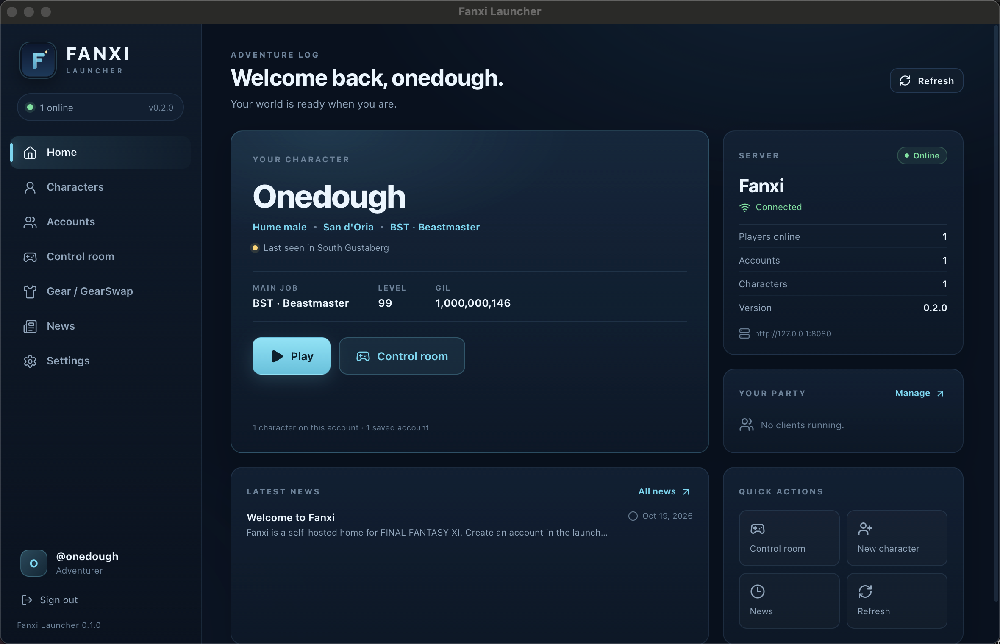

# Fanxi Launcher (Rust + Tauri)

The Fanxi Launcher: Rust with a Tauri 2 + React front end. It is the project's only desktop
launcher; the earlier Python/Tkinter app has been removed.



## What it does

- sign in, register, and keep a vault of saved accounts (tokens only, mode-0600);
- browse characters, create a mule, pick the active character, and press Play;
- a global **tenant** bar above every page: pick a main-account character or a sub-account box and
  Home, Design, Data, Gear and Warps follow it; the choice is saved in `launcher.json`;
- edit the whole merit menu on **Data → Merits** — the six general categories and every job's
  Group 1/2 as form groups, with per-menu caps, point costs and an optional spend-points rule;
- create server-owned sub-account boxes on **Team**, then launch a single box with a window or
  headless, or launch the whole team, without extra passwords or tokens;
- launch several clients, one per account, and watch live HP/MP, EXP/hr and DPS;
- show every main job with its support job — on Home, Characters, Team, Control, Warps, Data,
  Gear, Battle and the tenant bar — and list the whole team's job pairs plus the distinct jobs
  the team covers on the Team and Control pages;
- choose the display the launcher and the game open on, and the game window in Settings —
  windowed, borderless, full screen or borderless full screen, with width × height,
  display-fitting presets and an interface scale — and have the launcher apply it to every
  visible client it starts;
- call every other online box to the highlighted character with **Warp team to me** on the
  Control room or **Warps** page (`//warp all me`);
- send server commands and chat through the client's control port;
- toggle four in-game HUD windows per account — **Abilities**, **Spells**, **Trusts** and
  **Weapon skills** — with real game icons, `/ja` / `/ma` / `/ws` buttons, clock-face recasts,
  per-type grid/list/bar layouts with folder-tab group pages, grouping (job, magic type, element,
  trust job, weapon type or custom drag-and-drop groups), portrait trust buttons, TP-aware weapon-skill pages with skillchain elements and a window timer, compact bar pages, readable abbreviated
  labels and draggable overlay positions;
- read the active gear, load/import GearSwap libraries, edit sets (a bundled job library saves
  in place with a `.bak`), wear a set, quick-equip any slot from a searchable list of the
  wearable copies in the character's bags, and save a timestamped version;
- see the server's live stat sheet under the EquipViewer as a compact Stat/Total table, with a
  full-window drill-down naming the gear, food, JT/JA, job-point and buff sources behind each
  total;
- a launcher-wide **GearSwap** on/off switch in Settings and on the Gear page: off clears the
  auto-swap plan in every running client, and manual sets still work;
- an **EquipViewer** grid — the same 4×4 layout as Windower's addon — on the Home dashboard, the
  Control room, the Gear page and inside the set editor. Item icons are decoded from the
  player's own game DATs, the grid follows equipment changes, and it shows the ammo count and
  encumbrance X;
- find the game, build `host64`, stream the build log, and show server status/news.


The server remains the source of truth: besides the existing HTTP API, launch-token hand-off and
in-game control protocol, it now exposes a read-only `/characters/<id>/stats` report built from
the live zone session for the launcher's stat sheet.

## Requirements

- Rust 1.85+ (edition 2024; the project builds with the current stable toolchain).
- Node 18+ and npm.
- macOS: Xcode Command Line Tools; Linux: WebKitGTK 4.1 and the usual Tauri build packages;
  Windows: WebView2 (present on current Windows).
- For building the actual client: Python 3.9+, clang/CMake/Ninja, and your own FINAL FANTASY XI
  files. The launcher drives the existing `tools/build_posix.py`; it does not replace the
  recompiler yet.

## Run

```bash
cd launcher-rs
npm ci
npm run tauri dev
```

`../scripts/launcher.sh` starts the last release build when there is one and falls back to this
development command; `../install.sh` builds and installs the app for this OS.

The app reads and writes `launcher.json` in the platform data folder. The format is the one the
earlier Python launcher used, so existing settings and accounts load unchanged:

- macOS: `~/Library/Application Support/Fanxi/`
- Linux: `~/.local/share/fanxi/` (or `$XDG_DATA_HOME/fanxi/`)
- Windows: `%APPDATA%\Fanxi\`

`FANXI_LAUNCHER_DIR` overrides the folder (useful for testing).

## Build

```bash
npm run build                                   # TypeScript + Vite
npm run tauri build                             # .app/.dmg (macOS), MSI/NSIS (Windows), AppImage/deb
cargo test --manifest-path src-tauri/Cargo.toml # Rust core tests
npm run check                                   # TypeScript only
```

The macOS bundle copies the repository's `gearswap/` defaults into its Resources folder. The
client build still needs the checkout and its Python toolchain; set **Fanxi checkout** in Settings
if it is not auto-detected.

## Architecture

```text
src/                    React UI, one page per area
src/components/EquipViewer.tsx  the 4x4 live equipment grid
src/lib/api.ts          typed wrappers around Tauri commands
src-tauri/src/api.rs    Fanxi HTTP client (rustls)
src-tauri/src/config.rs launcher.json + account vault
src-tauri/src/control.rs local JSON-lines control port + process table
src-tauri/src/display.rs chosen display, game window overlay (mode, resolution, interface scale)
src-tauri/src/game.rs   game discovery, build driver, host64 spawn
src-tauri/src/gear.rs   GearSwap flatten/serialize/version helpers
src-tauri/src/icons.rs  item-icon cache (control port RGBA -> PNG data URL)
src-tauri/src/commands.rs Tauri command surface
```

The frontend never sees stored tokens: commands return a `ConfigView` without them, and the Rust
core keeps the token file private. All game processes are owned by the Rust side, so stopping a
client also releases its control port.
