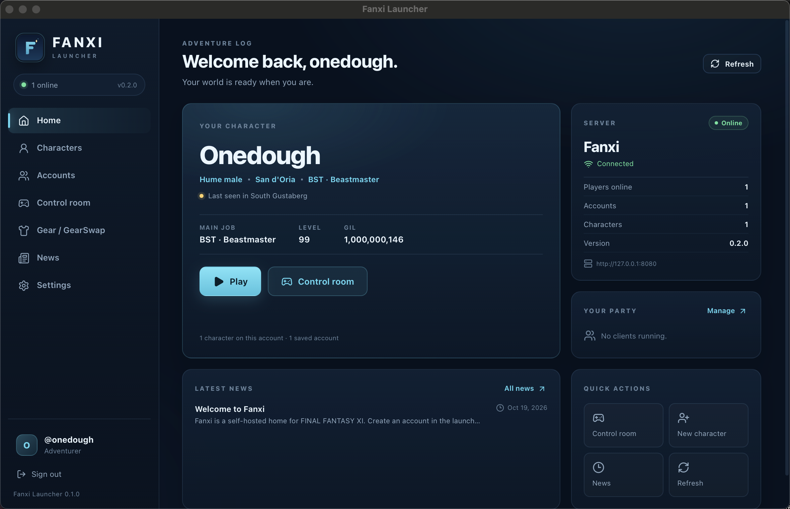

# Fanxi Launcher (Rust + Tauri)

A native desktop launcher for Fanxi, rebuilt in Rust with a Tauri 2 + React front end. It lives
side by side with the original Python/Tkinter launcher in `../launcher/` while parity is finished.



## What it does

- sign in, register, and keep a vault of saved accounts (tokens only, mode-0600);
- browse characters, create a mule, pick the active character, and press Play;
- launch several clients, one per account, and watch live HP/MP, EXP/hr and DPS;
- send server commands and chat through the client's control port;
- read the active gear, load/import GearSwap libraries, edit sets (a bundled job library saves
  in place with a `.bak`), wear a set, and save a timestamped version;
- a launcher-wide **GearSwap** on/off switch in Settings and on the Gear page: off clears the
  auto-swap plan in every running client, and manual sets still work;
- an **EquipViewer** grid — the same 4×4 layout as Windower's addon — on the Home dashboard, the
  Control room, the Gear page and inside the set editor. Item icons are decoded from the
  player's own game DATs, the grid follows equipment changes, and it shows the ammo count and
  encumbrance X;
- find the game, build `host64`, stream the build log, and show server status/news.


The server is unchanged: it still exposes the same HTTP API, launch-token hand-off, and in-game
control protocol.

## Requirements

- Rust 1.85+ (edition 2024; the project builds with the current stable toolchain).
- Node 18+ and npm.
- macOS: Xcode Command Line Tools; Linux: WebKitGTK 4.1 and the usual Tauri build packages;
  Windows: WebView2 (present on current Windows).
- For building the actual client: Python 3.9+, clang/CMake/Ninja, and your own FINAL FANTASY XI
  files. The launcher drives the existing `tools/build_posix.py`; it does not replace the
  recompiler yet.

## Run

```bash
cd launcher-rs
npm install
npm run tauri dev
```

The app reads and writes the same `launcher.json` and data folder as the Python launcher:

- macOS: `~/Library/Application Support/Fanxi/`
- Linux: `~/.local/share/fanxi/` (or `$XDG_DATA_HOME/fanxi/`)
- Windows: `%APPDATA%\Fanxi\`

`FANXI_LAUNCHER_DIR` overrides the folder. The old and new launchers can share it, but avoid
running both at once while testing account changes.

## Build

```bash
npm run build                                   # TypeScript + Vite
npm run tauri build                             # .app/.dmg (macOS), MSI/NSIS (Windows), AppImage/deb
cargo test --manifest-path src-tauri/Cargo.toml # Rust core tests
npm run check                                   # TypeScript only
```

The macOS bundle copies the repository's `gearswap/` defaults into its Resources folder. The
client build still needs the checkout and its Python toolchain; set **Fanxi checkout** in Settings
if it is not auto-detected.

## Architecture

```text
src/                    React UI, one page per area
src/components/EquipViewer.tsx  the 4x4 live equipment grid
src/lib/api.ts          typed wrappers around Tauri commands
src-tauri/src/api.rs    Fanxi HTTP client (rustls)
src-tauri/src/config.rs launcher.json + account vault
src-tauri/src/control.rs local JSON-lines control port + process table
src-tauri/src/game.rs   game discovery, build driver, host64 spawn
src-tauri/src/gear.rs   GearSwap flatten/serialize/version helpers
src-tauri/src/icons.rs  item-icon cache (control port RGBA -> PNG data URL)
src-tauri/src/commands.rs Tauri command surface
```

The frontend never sees stored tokens: commands return a `ConfigView` without them, and the Rust
core keeps the token file private. All game processes are owned by the Rust side, so stopping a
client also releases its control port.
